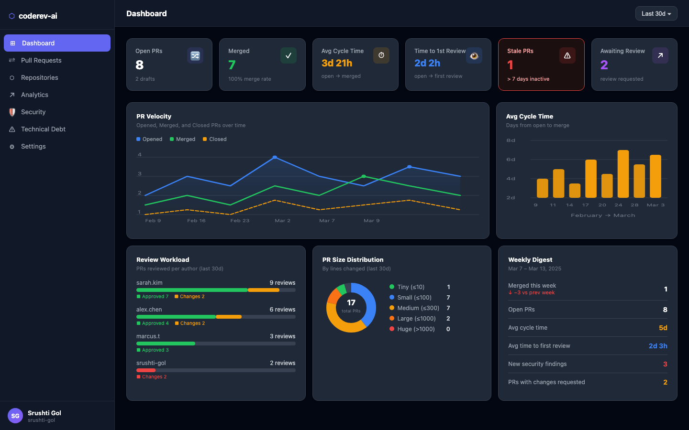
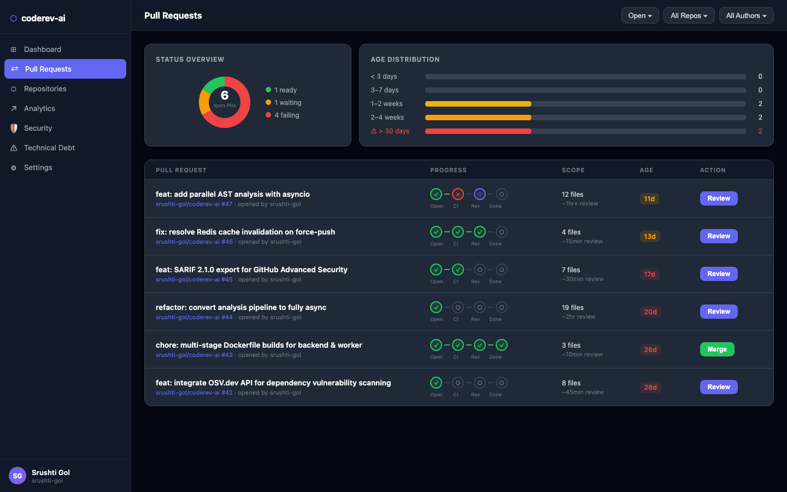
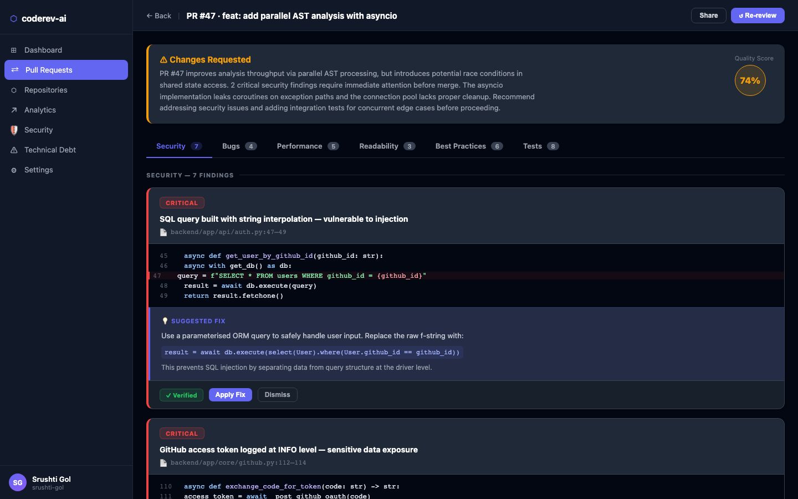
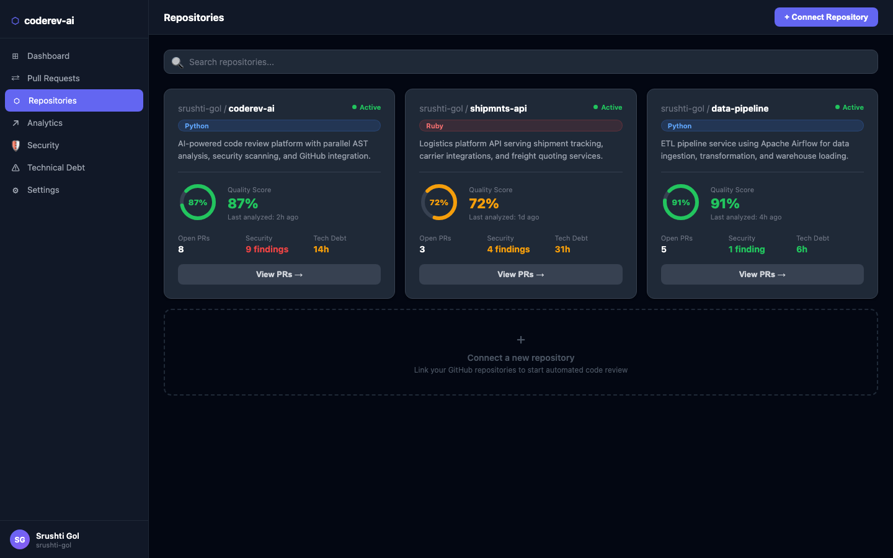
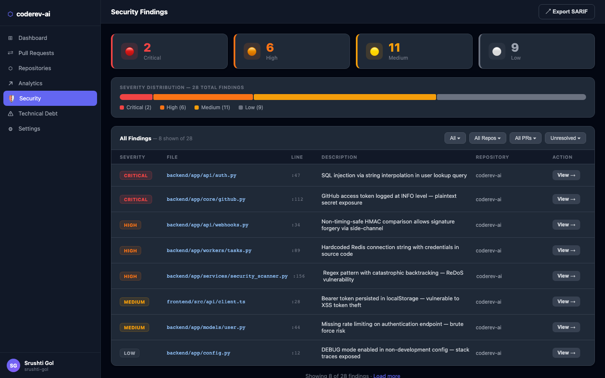
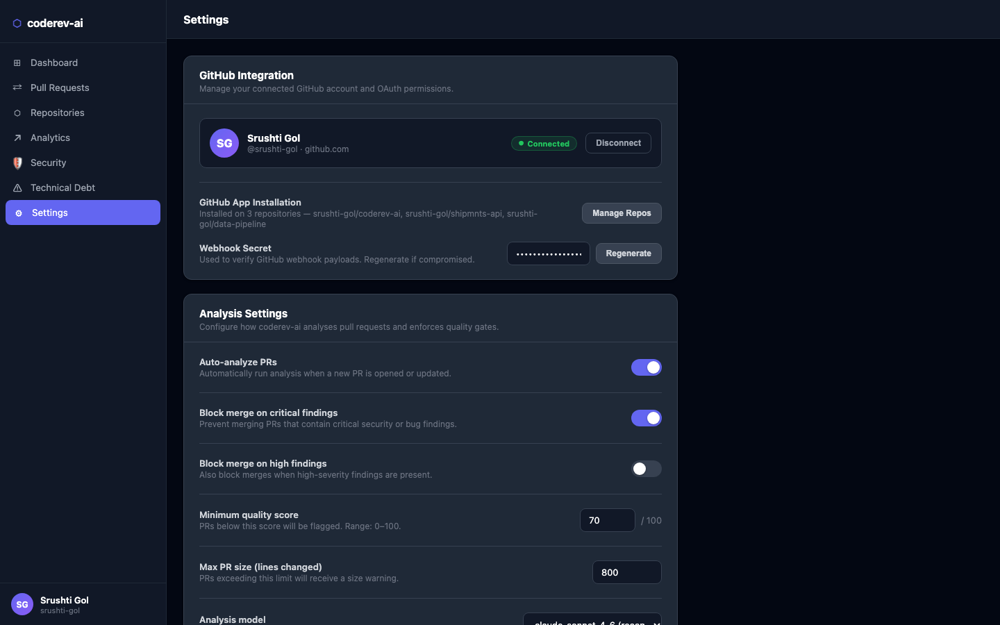

<div align="center">

# 🔍 CodeRev AI

### AI-Powered GitHub Code Review & Optimization Platform

[](https://python.org)
[](https://fastapi.tiangolo.com)
[](https://reactjs.org)
[](https://typescriptlang.org)
[](https://langchain-ai.github.io/langgraph)
[](LICENSE)

**Automatically review every pull request with the power of Claude AI + AST analysis.**  
Detect security vulnerabilities, performance bottlenecks, duplicate code, and technical debt — all before you merge.

[Features](#-features) · [Screenshots](#-screenshots) · [Quick Start](#-quick-start) · [Architecture](#-architecture) · [API Docs](#-api-reference)

</div>

---

## ✨ Features

| Category | Capability |
|---|---|
| **GitHub Integration** | OAuth login, repo sync, automatic PR webhooks, Check Run annotations |
| **AI Code Review** | LangGraph agent with Claude — reviews security, bugs, style, best practices |
| **Security Scanning** | SQL injection, XSS, hardcoded secrets, path traversal, command injection |
| **AST Analysis** | Tree-sitter parsing: cyclomatic complexity, duplicate blocks, dead code, long functions |
| **Performance** | N+1 query detection, synchronous I/O in async contexts, bottleneck hints |
| **Test Generation** | AI-generated unit tests, verified by running them before marking as confirmed |
| **Technical Debt** | Weighted debt score over time, cost estimation, release-to-release comparison |
| **Dashboard** | PR velocity, cycle time, review workload, size distribution, weekly digest |
| **Background Jobs** | Celery + Redis: async analysis, scheduled reports, stale PR alerts |
| **Caching** | Redis result cache — incremental scans skip unchanged files |
| **Cost Tracking** | Token usage and USD cost tracked per analysis, per repository |

---

## 📸 Screenshots

### Dashboard — PR Velocity & Metrics

> Real-time engineering metrics: open PRs, merge rate, avg cycle time, time to first review, stale PR alerts, and review workload — all in one view.



**Charts included:**
- 📈 PR Velocity — opened, merged, closed per week (line chart)
- ⏱ Avg Cycle Time — hours from open to merge per week (bar chart)
- 👥 Review Workload — reviews per author (horizontal bar)
- 🍩 PR Size Distribution — tiny / small / medium / large / huge (donut chart)
- 📅 Weekly Digest — merged, open PRs, cycle time vs prior week

---

### Pull Request List — Pipeline View

> Every PR shows its live pipeline stage (Opened → CI → Review → Done), age, scope, and one-click Review/Merge actions. Stale PRs highlighted in red.



---

### AI Code Review — Security & Analysis Findings

> Claude AI reads the full diff and posts structured findings across Security, Bugs, Performance, Readability, and Best Practices tabs — each with file path, line number, and a verified code fix.



---

### Repositories — Health Overview

> All connected repositories with live quality scores, open PR counts, language, and last-analysis timestamps.



---

### Security Findings — Vulnerability Report

> Full security scan results with CVSS-inspired severity scoring. Filter by severity, export as SARIF 2.1.0 for GitHub Advanced Security integration.



Detects SQL injection, hardcoded secrets, XSS, path traversal, command injection, insecure random, and weak cryptography.

---

### Settings — Integration & Analysis Config

> Configure GitHub integration, auto-analysis rules, quality gates, and Slack/email notification webhooks per repository.



---

## 🚀 Quick Start

### Prerequisites

- Docker & Docker Compose
- A GitHub OAuth App ([create one here](https://github.com/settings/applications/new))
- An Anthropic API key ([get one here](https://console.anthropic.com))

### 1. Clone & configure

```bash
git clone https://github.com/yourusername/coderev-ai.git
cd coderev-ai
cp .env.example .env
```

Edit `.env`:

```env
# GitHub OAuth
GITHUB_CLIENT_ID=your_github_client_id
GITHUB_CLIENT_SECRET=your_github_client_secret
GITHUB_WEBHOOK_SECRET=your_random_webhook_secret

# Anthropic
ANTHROPIC_API_KEY=sk-ant-...

# JWT
SECRET_KEY=your_random_secret_key_min_32_chars

# Database (defaults work with docker-compose)
DATABASE_URL=postgresql+asyncpg://coderev:coderev@db:5432/coderev
REDIS_URL=redis://redis:6379/0
```

### 2. Start everything

```bash
make dev
# or
docker-compose up --build
```

| Service | URL |
|---|---|
| Frontend | http://localhost:5173 |
| Backend API | http://localhost:8000 |
| API Docs (Swagger) | http://localhost:8000/docs |
| Flower (Celery monitor) | http://localhost:5555 |

### 3. Set up GitHub webhook

In your GitHub repo → Settings → Webhooks:
- **Payload URL:** `https://your-domain.com/api/webhooks/github`
- **Content type:** `application/json`
- **Secret:** value of `GITHUB_WEBHOOK_SECRET`
- **Events:** Pull requests

### 4. Connect your first repository

1. Log in with GitHub OAuth
2. Click **Repositories** → **Connect Repository**
3. Select a repo — the webhook is auto-installed
4. Open a PR — analysis starts automatically within seconds

---

## 🏗 Architecture

```
┌─────────────────────────────────────────────────────────────────┐
│                        React Frontend                           │
│   Dashboard · PR List · Analysis View · Repo Health · Settings  │
└────────────────────────┬────────────────────────────────────────┘
                         │ REST API (axios + React Query)
┌────────────────────────▼────────────────────────────────────────┐
│                    FastAPI Backend                               │
│   /auth  /repos  /prs  /analysis  /dashboard  /webhooks         │
└──┬──────────────────────────────────────────────┬───────────────┘
   │ SQLAlchemy (async)                           │ Celery tasks
┌──▼──────────┐  ┌──────────────┐  ┌─────────────▼───────────────┐
│  PostgreSQL  │  │    Redis     │  │       Celery Workers        │
│  (all data) │  │ cache+broker │  │  analyze_pr · gen_tests      │
└─────────────┘  └──────────────┘  │  verify_suggestion · reports │
                                   └─────────────┬───────────────┘
                              ┌──────────────────▼───────────────┐
                              │         Analysis Pipeline         │
                              │                                   │
                              │  GitHub API → fetch PR diff       │
                              │       ↓                           │
                              │  AST Analyzer (Tree-sitter)       │
                              │  · complexity · duplication       │
                              │  · dead code · long functions     │
                              │       ↓                           │
                              │  Security Scanner (regex+AST)     │
                              │  · SQLi · XSS · secrets · CVEs    │
                              │       ↓                           │
                              │  LangGraph AI Agent (Claude)      │
                              │  code_review → security_check     │
                              │  → optimization → test_generation │
                              │  → summarize                      │
                              │       ↓                           │
                              │  Debt Tracker + Cost Tracker      │
                              │       ↓                           │
                              │  Store findings → Post to GitHub  │
                              └──────────────────────────────────┘
```

### LangGraph Agent Graph

```python
StateGraph:
  code_review       # Bugs, style, best practices
      ↓
  security_check    # Vulnerabilities, CVE lookup
      ↓
  optimization      # Performance, refactoring suggestions
      ↓
  test_generation   # Unit tests for changed functions
      ↓
  summarize         # Overall PR verdict + confidence score
```

Each node uses `claude-sonnet-4-6` with structured JSON output. The graph checkpoints state to Redis so analysis can resume after worker restarts.

---

## 📁 Project Structure

```
coderev-ai/
├── backend/
│   ├── app/
│   │   ├── api/              # FastAPI routers
│   │   │   ├── auth.py       # GitHub OAuth
│   │   │   ├── repositories.py
│   │   │   ├── pull_requests.py
│   │   │   ├── analysis.py
│   │   │   ├── dashboard.py
│   │   │   └── webhooks.py
│   │   ├── core/
│   │   │   ├── security.py   # JWT
│   │   │   └── github.py     # GitHub API client
│   │   ├── models/           # SQLAlchemy ORM models
│   │   ├── schemas/          # Pydantic request/response schemas
│   │   ├── services/
│   │   │   ├── ai_reviewer.py      # LangGraph agent
│   │   │   ├── ast_analyzer.py     # Tree-sitter analysis
│   │   │   ├── security_scanner.py # Vulnerability patterns
│   │   │   ├── analysis_service.py # Orchestration pipeline
│   │   │   ├── debt_tracker.py     # Technical debt scoring
│   │   │   ├── cost_tracker.py     # Token/cost tracking
│   │   │   └── cache_service.py    # Redis caching
│   │   └── workers/
│   │       ├── celery_app.py
│   │       └── tasks.py      # analyze_pr, gen_tests, verify
│   ├── alembic/              # DB migrations
│   └── tests/
├── frontend/
│   └── src/
│       ├── api/              # axios API modules
│       ├── components/
│       │   ├── dashboard/    # Charts (Recharts)
│       │   ├── pr/           # PR list, detail, diff viewer
│       │   ├── analysis/     # Quality score, debt chart
│       │   ├── repositories/ # Repo card, list
│       │   ├── layout/       # Sidebar, header
│       │   └── ui/           # Badge, Button, Card, StatCard
│       ├── hooks/            # React Query hooks
│       ├── pages/            # Route-level page components
│       └── store/            # Zustand state
├── docker-compose.yml
├── Makefile
└── .env.example
```

---

## ⚙️ Advanced Configuration

### Model Selection

CodeRev AI automatically selects the Claude model based on PR size:

| PR Size | Model | Reason |
|---|---|---|
| < 200 lines | `claude-haiku-4-5` | Fast, cheap for small changes |
| 200–1000 lines | `claude-sonnet-4-6` | Balanced quality/cost |
| > 1000 lines | `claude-sonnet-4-6` with chunking | Full analysis in parallel |

### Custom Rules (`.coderev.yml`)

Place a `.coderev.yml` in your repository root:

```yaml
rules:
  max_function_lines: 60
  max_complexity: 10
  max_pr_lines: 800
  ignore_patterns:
    - "**/*.generated.ts"
    - "**/migrations/**"
  security:
    block_on_critical: true
    scan_dependencies: true
  notifications:
    slack_webhook: https://hooks.slack.com/...
    email: team@company.com
```

### Quality Gates

Block merges when thresholds aren't met:

```yaml
quality_gates:
  min_quality_score: 70
  max_critical_findings: 0
  max_high_findings: 3
  require_test_coverage: 80
```

---

## 🔌 API Reference

Full Swagger docs at `http://localhost:8000/docs`

| Method | Endpoint | Description |
|---|---|---|
| `GET` | `/auth/github` | Initiate GitHub OAuth |
| `GET` | `/auth/github/callback` | OAuth callback |
| `GET` | `/auth/me` | Current user info |
| `GET` | `/api/repositories` | List connected repos |
| `POST` | `/api/repositories` | Connect a repository |
| `GET` | `/api/repositories/{id}/prs` | List PRs for repo |
| `POST` | `/api/pull-requests/{id}/analyze` | Trigger analysis |
| `GET` | `/api/analysis/{pr_id}` | Get all findings |
| `GET` | `/api/analysis/{pr_id}/summary` | Analysis summary |
| `GET` | `/api/dashboard/stats` | Aggregate metrics |
| `GET` | `/api/dashboard/velocity` | PR velocity chart data |
| `GET` | `/api/dashboard/debt-score` | Technical debt over time |
| `POST` | `/api/webhooks/github` | GitHub webhook handler |
| `GET` | `/api/analysis/{pr_id}/export/sarif` | Export as SARIF |

---

## 🧪 Development

```bash
# Run backend tests
make test

# Run with hot reload
make dev

# Open a shell in the backend container
make shell-be

# Run Alembic migrations
make migrate

# Lint Python
cd backend && ruff check app/

# Lint TypeScript
cd frontend && npm run lint
```

---

## 🤝 Contributing

1. Fork the repository
2. Create a feature branch: `git checkout -b feat/amazing-feature`
3. Commit your changes: `git commit -m 'feat: add amazing feature'`
4. Push and open a PR — CodeRev AI will review it automatically 😄

---

## 📄 License

MIT License — see [LICENSE](LICENSE) for details.

---

<div align="center">

Built with ❤️ using [Claude](https://anthropic.com) · [FastAPI](https://fastapi.tiangolo.com) · [React](https://reactjs.org) · [LangGraph](https://langchain-ai.github.io/langgraph)

</div>
